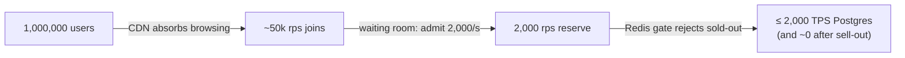

# 01 · Requirements & Capacity Planning

## 1. Business scope (deliberately small)

A ticket-booking platform for high-demand events (concerts, sports, flash sales).

| Capability | Behaviour |
|---|---|
| Browse events | Event + ticket tiers + near-real-time availability. Read-heavy, cacheable. |
| Waiting room | For hot events, users are queued FIFO and admitted at a controlled rate. |
| Reserve (hold) | Hold `quantity` tickets of a tier for `HOLD_TTL` (10 min). Max `max_per_user` per event. |
| Confirm (pay) | Charge the card, turn the hold into a confirmed booking. |
| Cancel | Release a hold. |
| Expire | Unpaid holds return to inventory automatically. |
| Notify | Users get push/email notifications for every state change. |

The domain is simple on purpose. Most of the engineering goes into making that simple logic **correct under extreme concurrency** and **stable under failure**.

## 2. Non-functional requirements

| # | Requirement | Target |
|---|---|---|
| N1 | Registered users | 10 M |
| N2 | Peak concurrent users (sale opening) | 1 M |
| N3 | **Never oversell** a ticket, never double-charge | Hard invariant (enforced by the DB) |
| N4 | Reserve latency for admitted users | p95 < 500 ms, p99 < 1.5 s |
| N5 | Waiting-room status latency | p99 < 100 ms |
| N6 | Availability (booking path) | 99.95 % monthly; survive loss of 1 AZ with no data loss |
| N7 | Graceful degradation | Redis, Kafka, or payment-provider outage must not cause oversell or data loss |
| N8 | RPO / RTO (regional disaster) | RPO ≤ 1 min, RTO ≤ 30 min (warm standby region) |
| N9 | Fairness | FIFO admission; per-user limits; bot/abuse rate limiting |

## 3. Traffic model for a sale day

Assumptions: one hot event with **50,000 tickets**; **1,000,000** people show up; the average buyer takes 2 tickets.

```mermaid
gantt
    dateFormat  HH:mm
    axisFormat  %H:%M
    title Sale-day traffic phases
    section Users
    Arrive & browse (CDN)            :a1, 09:50, 10m
    T0 join stampede                 :crit, a2, 10:00, 2m
    Queue polling                    :a3, 10:00, 40m
    Admitted users reserve           :a4, 10:00, 30m
    Pay within hold window           :a5, 10:00, 40m
```

| Phase | Request type | Rate estimate | Served by |
|---|---|---|---|
| Pre-sale browse | `GET /events/:id` | 1 M page views in 10 min → ~2k rps avg, 20k rps bursts | **CDN** (max-age 2 s) → origin sees roughly 1 req/s per PoP |
| T0 join | `POST /queue/:id/join` | 1 M joins in ~60 s → **17k rps avg, ~50k rps peak** | Gateway + **1 Redis Lua call** each |
| Queue polling | `GET /queue/:id/status` | 1 M users ÷ 3–10 s poll interval → **~150k rps** | Gateway memory only (**0 Redis calls**) |
| Reserve | `POST /reservations` | = admission rate, e.g. **2,000/s** | Redis gate → Postgres |
| Sold-out tail | `POST /reservations` | All later admits | **Redis gate** rejects in O(1); never touches Postgres |
| Confirm | `POST /reservations/:id/confirm` | ~25k buyers over ~10 min → **40–100 rps** | Postgres + payment provider |
| Events | Kafka | ~4 events per buyer → < 1k msg/s | Kafka (trivial) |

**Key insight.** 1 M users does not mean 1 M database transactions per second. The architecture turns a 1 M-user crowd into roughly 2,000 DB writes/s:

## 4. Sizing (per region, peak)

### Gateway (Node.js)

* A 1-vCPU pod handles about 3–5k rps of JWT-verify + JSON work (HS256 verify ≈ 20–40 µs).
* Peak ≈ 50k (join) + 150k (status) rps → **~60–80 pods × 1 vCPU** with 30 % headroom.
* HPA min 10 / max 120. **Pre-scale to 60 one hour before the sale.** Reactive autoscaling is too slow for a 0 → 50k rps step.

### Booking API (Go)

* One reserve ≈ 5 SQL statements in one short transaction (~3–6 ms DB time).
* At 2,000 rps, about 12–24 concurrent transactions are in flight cluster-wide. Go pods are mostly waiting on I/O.
* **6–20 pods × 2 vCPU** is plenty. The scaling limit is the database, not the pods. HPA max is set to protect PgBouncer.

### PostgreSQL (primary)

| Item | Value |
|---|---|
| Write TPS needed | ~2–3k (reserve + confirm + expiry + outbox relay) |
| Instance | 16 vCPU / 128 GB (e.g. `db.r7g.4xlarge`, Cloud SQL `db-perf-optimized-N-16`, Azure `E16ds_v5`) |
| Server connections | 64–100 (≈ 4–6 × vCPU), all via PgBouncer / RDS Proxy |
| Client connections | 20 API pods × 40 = 800 → multiplexed by the pooler |
| Inventory shards | 64 rows per 48k-ticket tier → 64-way parallelism on the hottest data |
| Replicas | 1 synchronous standby (other AZ) + 1–2 async read replicas (catalog reads) |

### Redis

* Waiting-room keys for one event share a hash slot, so ~50k Lua ops/s land on **one shard**. A single Redis shard handles >100k ops/s, so this is fine.
* Stock counters: one key per tier, 2k ops/s.
* Rate limits: 1 Lua call per write request.
* **3 shards × (primary + replica), multi-AZ, `noeviction`.** Use a separate Redis for disposable caches, so cache pressure can never evict stock or queue state.

### Kafka

* 3 brokers (multi-AZ), `booking.events` with 12–24 partitions, RF=3, `min.insync.replicas=2`, producer `acks=all`.

## 5. Storage growth (steady state)

| Table | Rows / year | Size / row (incl. idx) | Notes |
|---|---|---|---|
| reservations | ~100 M | ~0.6 KB | ~60 GB/yr. Partition by `created_at` month at scale; archive > 1 y to object storage |
| outbox | transient | — | Rows deleted 24 h after publish |
| processed_events | ~400 M | ~60 B | Partition by day, drop after 7 d (longer than any redelivery window) |
| inventory_shards | tiny | — | Hot rows; `fillfactor=70` keeps updates HOT |

## 6. Capacity levers, in order of preference

1. **Admission rate** (`wr:{event}:rate` in Redis, changeable live). The main control.
2. **CDN TTLs** for catalog pages.
3. **Status poll interval** (`poll_after_sec`, already adaptive to queue position).
4. **Gateway replicas.** Stateless, scale freely.
5. **Inventory shard count** per tier (more parallelism on hot rows).
6. **Booking API replicas.** Bounded by DB connections.
7. **DB instance size / read replicas.** Slowest to change; size ahead of time.
