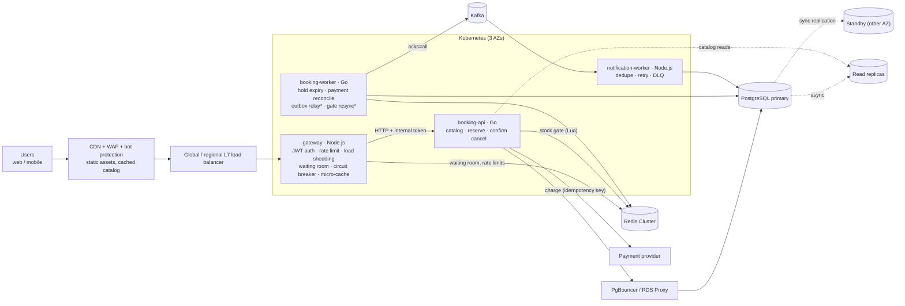
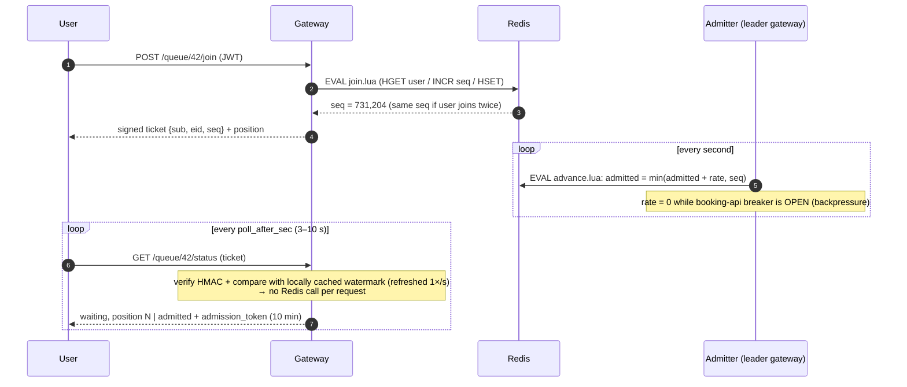
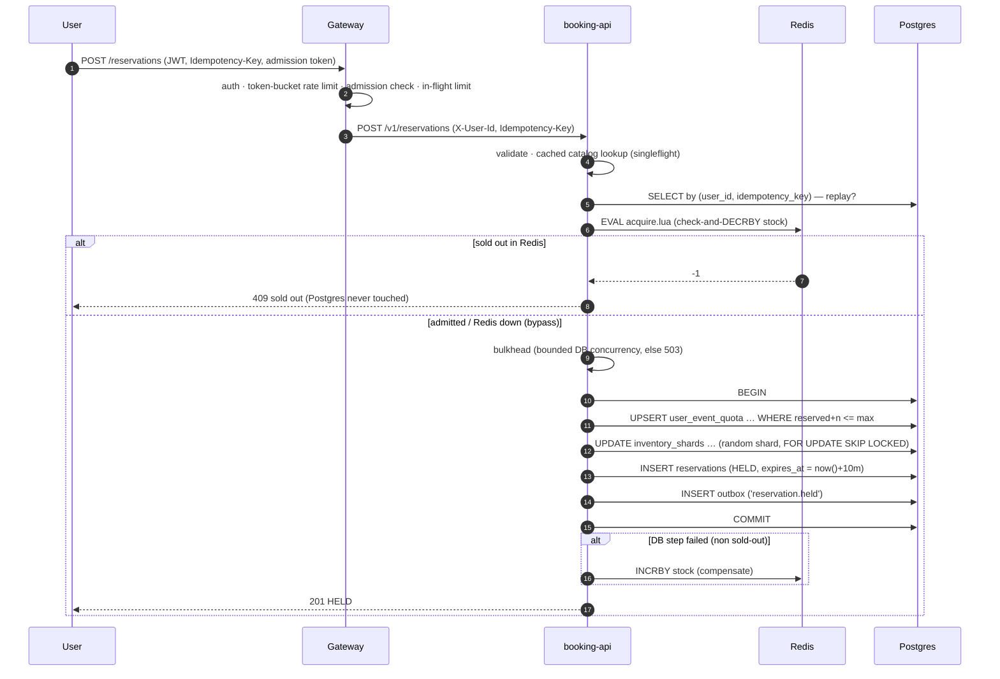
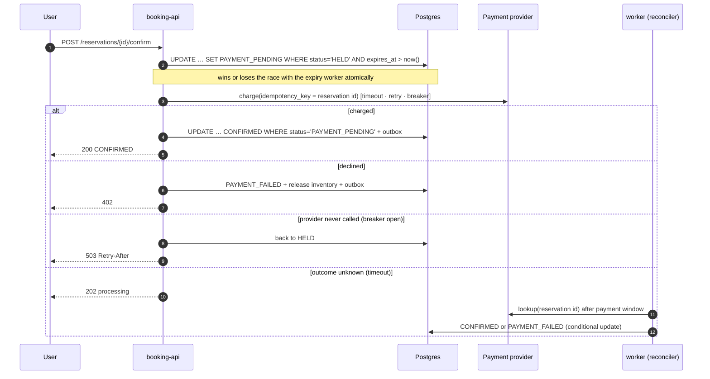
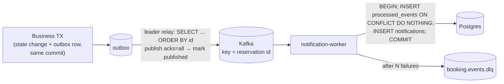

# 02 · Architecture

## 1. Component overview

\* leader-elected (one active replica; the others are hot standbys).

| Component | Language | Stateless? | Scales on | Responsibility |
|---|---|---|---|---|
| `services/gateway` | Node.js (Fastify) | yes | CPU / rps | Edge concerns: authN, per-user rate limits, load shedding, **virtual waiting room**, circuit breaker to booking-api, 1 s micro-cache + request collapsing for catalog |
| `services/booking-service` `api` | Go | yes | CPU (bounded by DB) | Business rules and all **write transactions**; Redis stock gate; idempotency |
| `services/booking-service` `worker` | Go | yes | fixed 2–3 | Hold expiry, payment reconciliation, transactional-outbox relay, Redis↔Postgres reconciliation |
| `services/notification-worker` | Node.js | yes | Kafka lag (KEDA) | Consumes domain events, exactly-once effect via de-duplication, retries + DLQ |
| PostgreSQL | — | — | vertical + replicas | **Source of truth** for inventory, reservations, quotas, outbox |
| Redis | — | — | shards | Fast, *disposable* state: stock gate, waiting room, rate limits |
| Kafka | — | — | partitions | Durable async fan-out of domain events |

> The existing `user-service` (root of the repo) issues HS256 JWTs with a `user_id` claim. The gateway verifies exactly that token format, so it plugs in unchanged.

## 2. Request flows

### 2.1 Sale opening: waiting room → admission

### 2.2 Reserve (the hot path)

### 2.3 Confirm (payment)

### 2.4 Events: transactional outbox → Kafka → consumers

## 3. Design principles

1. **The database is the only source of truth for invariants.** Inventory can't go negative (`CHECK`), idempotency keys are unique (`UNIQUE`), and state transitions are conditional `UPDATE`s. Every other layer (Redis gate, gateway checks, waiting room) only improves efficiency. If one of them fails, correctness still holds.
2. **Shed load early and cheaply.** CDN → waiting room → rate limit → in-flight limit → Redis gate → bulkhead → DB. Each layer is cheaper than the next and rejects with a *fast* `429/503 + Retry-After` instead of queueing.
3. **Every write is idempotent.** Client `Idempotency-Key`, reservation id as payment key, event id for consumers. Retrying is always safe, so every layer may retry.
4. **No distributed transactions.** Use local transactions plus the outbox, compensations (Redis release, refund), and reconcilers that converge state.
5. **Short transactions, no lock waits on hot rows.** Inventory is sharded across rows and taken with `SKIP LOCKED`. Lock order is fixed (quota → shards) to rule out deadlocks.
6. **Stateless compute, managed state.** Pods can be killed at any moment. Leadership for single-writer jobs uses DB advisory locks, which are released automatically if the holder dies.
7. **Degrade, don't die.** Redis down → DB-only mode behind a bulkhead. Kafka down → events buffer in the outbox. Payment provider down → holds are kept, users retry. Read replica down → read from primary.

## 4. Code map

| Concern | File |
|---|---|
| Schema & DB-level invariants | `services/booking-service/internal/db/migrations/0001_init.sql` |
| Reserve / confirm / cancel / expire / reconcile | `services/booking-service/internal/booking/service.go` |
| Redis stock gate (Lua) | `services/booking-service/internal/inventory/gate.go` |
| Catalog cache + singleflight | `services/booking-service/internal/catalog/catalog.go` |
| Payment client (idempotency, retry, breaker) | `services/booking-service/internal/payment/payment.go` |
| Circuit breaker / retry / bulkhead | `services/booking-service/internal/resilience/` |
| Advisory-lock leader election, tx retry | `services/booking-service/internal/db/` |
| Outbox relay & background loops | `services/booking-service/internal/worker/worker.go` |
| Load shedding, graceful drain, error mapping | `services/booking-service/internal/httpapi/server.go` |
| Waiting room | `services/gateway/src/lib/waitingRoom.js` |
| Rate limiting (Redis + local fallback) | `services/gateway/src/lib/rateLimiter.js` |
| Upstream client + breaker | `services/gateway/src/lib/upstream.js`, `circuitBreaker.js` |
| Consumer dedupe / retry / DLQ | `services/notification-worker/src/handler.js` |
| Concurrency proofs (tests) | `services/booking-service/internal/booking/service_integration_test.go` |
