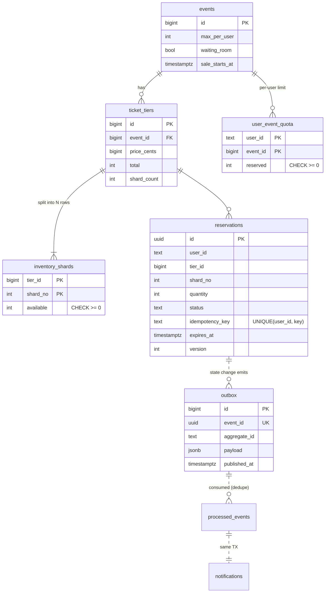
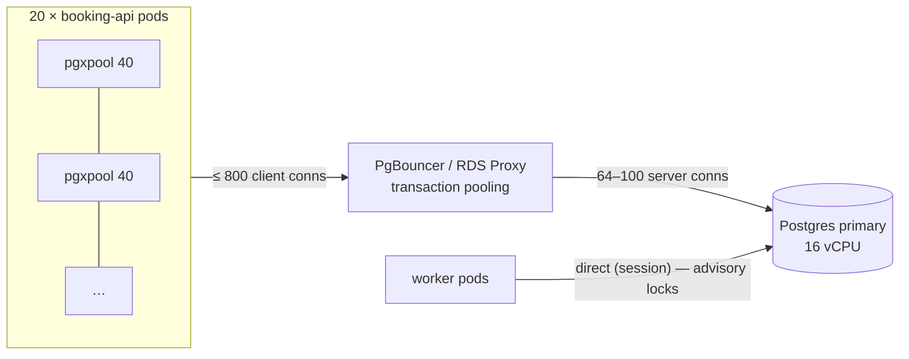

# 03 · Data Model & Database Scaling

## 1. Schema



Source: [`0001_init.sql`](../services/booking-service/internal/db/migrations/0001_init.sql).

### Constraints doing the real work

| Constraint | Protects against |
|---|---|
| `inventory_shards.available >= 0` (CHECK) | Overselling, even if application logic has a bug |
| `reservations UNIQUE (user_id, idempotency_key)` | Duplicate reservations from client/gateway retries |
| `user_event_quota.reserved >= 0` + conditional upsert | Bots exceeding per-user limits via parallel requests |
| `status CHECK (...)` + conditional `UPDATE … WHERE status = …` | Illegal / double state transitions |
| `outbox.event_id UNIQUE` + `processed_events PK` | Duplicate side effects downstream |

### Indexes tuned to the access paths

* `idx_reservations_held_expiry ON (expires_at) WHERE status='HELD'`: a partial index, so the expiry worker scans only live holds (KBs, not GBs).
* `idx_reservations_payment_pending`: same idea for the payment reconciler.
* `idx_outbox_unpublished ON (id) WHERE published_at IS NULL`: the relay reads only the backlog.
* `fillfactor=70` on `inventory_shards` and `80` on `user_event_quota`: leaves free space per page so the very frequent `UPDATE`s are **HOT updates** (no index writes, less WAL, less bloat).

## 2. Hot-row contention: inventory sharding

A naive `UPDATE ticket_tiers SET available = available - 1 WHERE id = 7` serialises **every** buyer of tier 7 on one row lock. At ~3 ms per transaction that caps a tier at ~300 sales/s, and the queue of waiting lock holders explodes latency.

Here each tier's stock is split across `shard_count` rows (≈ 1 per 500 tickets, max 64):

```sql
UPDATE inventory_shards SET available = available - $2
WHERE tier_id = $1 AND shard_no = (
    SELECT shard_no FROM inventory_shards
    WHERE tier_id = $1 AND available >= $2
    ORDER BY random() LIMIT 1
    FOR UPDATE SKIP LOCKED)          -- never wait behind another buyer
RETURNING shard_no;
```

* Throughput scales roughly linearly with shards (64 shards ≈ 64× the single-row ceiling).
* `SKIP LOCKED` means a buyer never waits on a lock; it simply takes a different shard.
* If every shard with stock is momentarily locked, the code backs off for 1–5 ms and retries (bounded). After that it returns `503 Retry-After`, never a long lock wait (`takeFromShard` in `service.go`).
* Trade-off: a request for `n` tickets must fit in **one** shard. Near sell-out, 3 tickets might be spread across 3 shards, so a request for 2 fails while a request for 1 succeeds. This is acceptable for ticketing (users can retry with a smaller quantity). Small tiers use a single shard.

## 3. Connection management



* Postgres performs best with active connections ≈ 2–4 × vCPU. More connections means more context switching and lock contention, not more throughput.
* **Bulkhead** in every API pod (`DB_WRITE_CONCURRENCY`) limits concurrent write transactions and sheds the excess as 503. This prevents a burst from consuming the whole pool and starving health checks.
* Timeouts are set **on the DB role** (`0002_role_timeouts.sql`): `statement_timeout=3s`, `lock_timeout=2s`, `idle_in_transaction_session_timeout=10s`. They work through PgBouncer, and a stuck client can never hold locks for long.
* `MaxConnLifetime` 5 min ± jitter: after a failover or DNS change, pods converge on the new primary without restarts.
* Workers bypass the pooler, because session-level advisory locks need a dedicated session.

## 4. Read scaling

* Catalog reads go to `DATABASE_REPLICA_URL` (async read replicas) and are cached in-process (5 s + jitter, singleflight) plus at the gateway (1 s) plus at the CDN (2 s).
* **Anything that decides money or inventory reads the primary.** Replica lag must never influence a booking decision.
* Availability numbers shown to users come from the Redis counter, which is advisory. The reserve call is authoritative.

## 5. Growing beyond one primary

The design keeps the write path narrow (≈ 2–3k TPS for a 1 M-user sale), so one well-sized primary is enough for a long time. When it isn't:

| Step | Trigger | Approach |
|---|---|---|
| 1. Vertical | CPU > 60 % at peak | Next instance size (minutes of failover on managed PG) |
| 2. Partition big tables | reservations > ~500 M rows | Declarative partitioning by `created_at` (monthly). Note: unique constraints must include the partition key, so idempotency moves to `(user_id, idempotency_key, created_month)` or to a dedicated `idempotency_keys` table |
| 3. Archive | Data > 1 year | Detach old partitions → Parquet in object storage |
| 4. Functional split | Different workloads compete | Separate DBs: booking (OLTP), notifications, analytics (CDC → warehouse) |
| 5. Horizontal sharding | Many concurrent mega-sales | Shard by `event_id` (Citus / application-level routing). All rows of a sale live on one shard, so transactions stay single-node |

## 6. Backups & recovery

* Continuous WAL archiving / PITR (managed service default), retention ≥ 7 days.
* Synchronous standby in another AZ: **RPO = 0** for AZ loss; automated failover in about 30–60 s (the app retries `57P01`/`57P03`/`25006` and connection errors transparently, see `db.IsRetryable`).
* Cross-region async replica (or Aurora Global / Cloud SQL cross-region replica / Azure geo-replica): **RPO ≈ seconds** for region loss.
* Quarterly restore drill: restore PITR into a scratch instance and run the invariant checks from `docs/06`.
