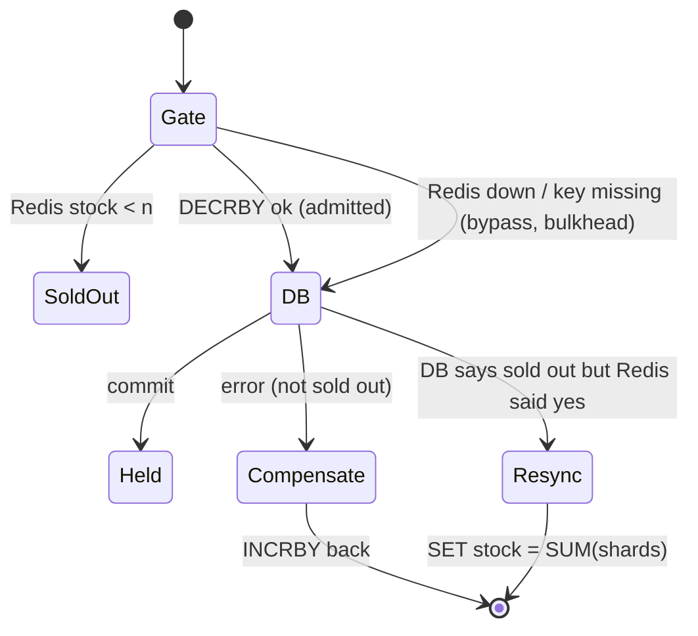
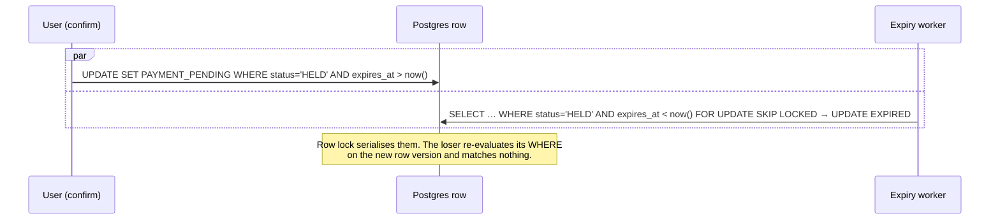

# 04 · Race Conditions: Catalogue & Solutions

Every race below has a concrete mechanism in the code and, where practical, an automated test that reproduces it with real parallelism against real Postgres and Redis (`go test -race`).

| # | Race | Mechanism | Test |
|---|---|---|---|
| R1 | Two buyers take the last ticket | Conditional decrement + `CHECK (available >= 0)` | `TestNoOversellUnderContention` |
| R2 | 2,000 buyers on one tier (hot row) | Inventory sharding + `FOR UPDATE SKIP LOCKED` | `TestNoOversellUnderContention` |
| R3 | Redis and Postgres disagree on stock | Redis is only a gate; DB decides; reconciler resyncs | `TestGateDriftIsRepaired` |
| R4 | Redis down mid-sale | Breaker → bypass → DB bulkhead | `TestNoOversellUnderContention/redis_down` |
| R5 | Same user, many tabs, exceeds limit | Atomic conditional upsert on `user_event_quota` | `TestPerUserLimitUnderParallelRequests` |
| R6 | Client retries the same request | `UNIQUE (user_id, idempotency_key)` | `TestIdempotentRetriesCreateOneReservation` |
| R7 | User pays at the same instant the hold expires | Conditional transitions on `status` + `expires_at` | `TestConfirmRacingExpiry` |
| R8 | Payment succeeded but response lost / crash mid-payment | `PAYMENT_PENDING` state + provider lookup reconciler | `TestPaymentUnknownOutcomeIsReconciled` |
| R9 | Late charge after reconciler already failed the booking | Conditional confirm fails → automatic refund | `Confirm()` "lost the race" branch |
| R10 | Double cancel / cancel by another user | Conditional update scoped by `user_id` | `TestCancelIsIdempotentAndReleasesQuota` |
| R11 | Many expiry workers process the same holds | `FOR UPDATE SKIP LOCKED` batches | `TestConfirmRacingExpiry` (2 sweepers) |
| R12 | Reserve vs release deadlock | Global lock order: quota rows → shard rows (sorted) | design + `40P01` retry |
| R13 | Two outbox relays reorder events | Advisory-lock leader election | `TestLeaderElectionFailsOver` |
| R14 | Relay crashes after publish, before marking | At-least-once + consumer dedupe in same TX | `TestOutboxSurvivesBrokerOutage`, `duplicate deliveries…` (Node) |
| R15 | N replicas run migrations at boot | `pg_advisory_lock` around migrations | `db.Migrate` |
| R16 | Cache expiry stampede (thundering herd) | singleflight + jittered TTL + serve-stale | `collapses concurrent catalog reads…` (Node) |
| R17 | User double-clicks "join queue" | Lua `HGET`/`INCR`/`HSET` is atomic, idempotent per user | `join is idempotent and FIFO…` (Node) |
| R18 | Two gateways both advance the queue | Redis `SET NX PX` lease + compare-and-renew | `only one gateway instance is the admitter` |
| R19 | Clock skew between pods | All deadlines computed with DB `now()` | design |

---

## R1/R2: Overselling and hot rows

**Problem.** Read-then-write (`SELECT available` … `UPDATE available = x - 1`) lets two transactions read `1` and both sell it.

**Solution.** The check and the write are one atomic statement on a locked row. The DB constraint is a backstop:

```sql
-- Conditional: only matches a shard that still has enough stock; the row
-- lock taken by FOR UPDATE makes the check+decrement atomic.
UPDATE inventory_shards SET available = available - $2
WHERE tier_id = $1 AND shard_no = (SELECT … WHERE available >= $2 … FOR UPDATE SKIP LOCKED)
RETURNING shard_no;
-- plus: CONSTRAINT inventory_non_negative CHECK (available >= 0)
```

Measured locally: 2,000 goroutines released simultaneously on a 300-ticket tier (8 shards) produce **exactly 300 holds**, 1,700 clean "sold out" answers, 0 errors, with or without Redis.

## R3/R4: Redis gate vs Postgres truth



* The gate only **reduces** load. Even if Redis says "1000 left" when there are 0, Postgres rejects every attempt (`TestGateDriftIsRepaired` sets Redis to 1000 on a 5-ticket tier: exactly 5 sell).
* Ordering rule: **decrement Redis before the DB; increment Redis only after the DB commits.** A crash at any point leaves Redis *lower* than the truth (temporary undersell). It is never higher in a way that matters, and the periodic leader-elected resync heals it within `RECONCILE_INTERVAL`.
* When the DB says "sold out" after Redis admitted, the code does **not** give the token back. It triggers an immediate (debounced, cross-replica) resync instead.

## R5: Per-user limit under parallel requests

A bot opening 40 tabs sends 40 reserve requests at once with different idempotency keys:

```sql
INSERT INTO user_event_quota (user_id, event_id, reserved) VALUES ($1,$2,$n)
ON CONFLICT (user_id, event_id) DO UPDATE
   SET reserved = user_event_quota.reserved + EXCLUDED.reserved
 WHERE user_event_quota.reserved + EXCLUDED.reserved <= $max
RETURNING reserved;      -- no row ⇒ limit exceeded
```

The upsert serialises on the `(user, event)` row; each request sees the previous one's increment. Result: exactly 4 succeed, 36 get `422`. The quota row is decremented when a hold is cancelled, expires, or fails payment.

## R6: Idempotent retries

Mobile clients and the gateway retry on timeouts. Each reserve carries `Idempotency-Key`:

1. Fast path: `SELECT … WHERE user_id=$1 AND idempotency_key=$2` returns the original (`200`, `Idempotent-Replayed: true`).
2. Concurrent duplicates both miss the fast path. The second `INSERT` blocks on the unique index until the first commits, then fails with `23505`. Its whole transaction (quota and stock decrements) rolls back, its Redis token is returned, and the original reservation is returned.

Test: 50 parallel identical requests produce one reservation, inventory reduced once, Redis consistent.

## R7: Confirm vs. expiry



* The **money step happens only after** the user's transaction wins (`PAYMENT_PENDING` is committed before calling the PSP). An expired hold can never be charged.
* `PAYMENT_PENDING` rows are invisible to the hold-expiry worker; they have their own reconciler.
* Test: 100 holds with deadlines 100 ms out, confirms fired at random 0–200 ms, two sweepers running. Each run gives a mix (e.g. 45 confirmed / 55 expired). Every reservation ends in exactly one state, `charges == confirmed`, and inventory is conserved.

## R8/R9: Payment uncertainty

A PSP timeout means *unknown*, not *failed*. Rules:

| Outcome | Action |
|---|---|
| Success | `PAYMENT_PENDING → CONFIRMED` |
| Definitive decline | `→ PAYMENT_FAILED`, release stock |
| Breaker open (PSP never called) | `→ HELD` again (with ≥ 60 s grace), `503 Retry-After` |
| Timeout / 5xx (unknown) | stay `PAYMENT_PENDING`, `202`; reconciler calls `lookup(reservation_id)` after `PAYMENT_WINDOW` |

The reservation id is the PSP idempotency key, so the user's retries, our internal retries, and the reconciler can never double-charge. If the reconciler has already failed the reservation and a charge then lands late, the conditional confirm fails and the code **refunds automatically**.

## R12: Deadlocks

All transactions lock in the same global order:

1. reservation row (state transitions),
2. `user_event_quota` rows, sorted by `(user_id, event_id)`,
3. `inventory_shards` rows, sorted by `(tier_id, shard_no)`.

`releaseInventory` sorts its batch to follow that order. Reserve never waits on shard locks (`SKIP LOCKED`). Postgres' deadlock detector is still a backstop, and `40P01` is retried transparently by `db.WithTx`.

## R13/R14: Event ordering and duplicates

* One relay at a time (advisory lock `7242101`) reads `ORDER BY id`, so publishing order matches commit order per partition key. When the leader dies, its DB session drops, the lock frees, and a standby takes over within one retry interval (2 s in production config; verified by `TestLeaderElectionFailsOver`).
* Crash between `Publish` and `UPDATE published_at` means a re-publish. Consumers insert `processed_events(consumer, event_id)` **in the same transaction** as their side effect. The duplicate inserts nothing and is skipped. Test: 20 concurrent deliveries of one event produce 1 notification.
* Payloads carry `version`, so consumers that need strict ordering can drop stale versions.

## R16: Cache stampede

When a hot catalog entry expires under 100k rps:

* **Go service**: `singleflight` collapses concurrent misses into one DB query per key per pod. TTL has ±50 % jitter. On DB error the stale entry is served.
* **Gateway**: in-flight promise sharing (one upstream call per key per second per instance) plus serve-stale on upstream error.
* **CDN**: `stale-while-revalidate`.

## R19: Clocks

`expires_at` is always computed in SQL (`now() + make_interval(...)`) and compared with the DB's `now()`. Pod clock skew therefore cannot extend or shorten holds. Gateway admission tokens use `exp` with standard JWT leeway.
