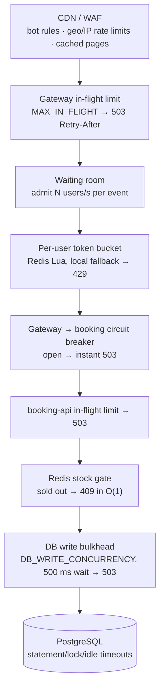
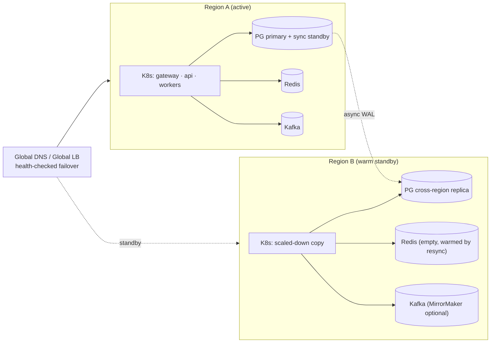

# 05 · Resilience, Fallback & Failover

## 1. Defence in depth: the load-shedding funnel



Each stage rejects **fast** with a status code that tells the client what to do: `429`/`503` with `Retry-After` means retry with the same idempotency key; `409` means a final answer. A fast rejection costs microseconds. A request queued until it times out costs a connection, memory, and usually a client retry, which is how retry storms and cascading failures start.

## 2. Failure-mode matrix

| Failure | Detection | Automatic behaviour | User impact | Data risk |
|---|---|---|---|---|
| **booking-api pod crash** | readiness/liveness | LB/Service routes around; HPA/Deployment replaces | In-flight requests fail, then the client retries with same key | None (idempotent) |
| **Gateway pod crash** | readiness | Same. Queue tickets are signed, so any pod can serve any user | None noticeable | None |
| **Rolling deploy** | — | `/readyz` → 503 (drain), sleep, `Shutdown()` waits for in-flight; `maxUnavailable: 0` | None | None |
| **AZ loss** | cloud | Pods spread across 3 AZs (`topologySpreadConstraints`); DB fails over to sync standby; Redis replica promoted | ~30–60 s elevated errors/retries during DB failover | **RPO 0** (sync standby) |
| **Postgres primary failover** | conn errors, `57P01`/`25006` | `db.IsRetryable` → whole-TX retry with jittered backoff; pool recycles conns (5 min lifetime) | Some 503s for ~30–60 s, retried by clients | None |
| **Read replica down/lagging** | connect error | Catalog falls back to primary, serves stale cache | None | None |
| **Redis down** | `redis` breaker opens after 5 errors | **Degraded mode:** stock gate bypassed (DB decides, bulkhead protects); rate limits fall back to per-pod buckets; queue status keeps serving the last watermark; `join` returns 503 | Slower sell-out, users in queue wait longer | None (DB is truth) |
| **Redis data loss / failover to stale replica** | resync job | Leader resync rewrites stock from Postgres every 30 s, and immediately on DB/Redis disagreement | A few seconds of over/under-admission | None |
| **Kafka down** | publish errors | Relay backs off (≤ 10 s). Events **accumulate in `outbox`** (in the DB, in the same TX). Bookings continue | Notifications delayed | None |
| **Outbox relay leader dies** | session drop | Advisory lock released; standby elected within ~2 s | Notifications delayed seconds | None |
| **Consumer bug / poison message** | handler throws | 5 retries with backoff → **DLQ** with error headers; partition keeps moving | That one notification delayed | None (replayable from DLQ) |
| **Payment provider slow/down** | timeouts, `payment` breaker | Timeout 5 s, 3 retries (same key), breaker opens → `revertToHeld`, `503 Retry-After` | User asked to retry; hold kept | None (no double charge) |
| **Payment outcome unknown** | timeout after send | `PAYMENT_PENDING`; reconciler resolves via provider lookup | "Processing…" for ≤ payment window | None |
| **Worker pods all down** | alert | Holds stay HELD past expiry (stock is not released until workers return); no data loss | Fewer tickets available temporarily | None |
| **Traffic far above plan** | shed counters, p99 | Waiting room absorbs; in-flight limits shed; HPA scales | Longer queue | None |
| **Region loss** | health checks | DNS / global LB fails over to warm standby region; promote DB replica (runbook) | Minutes of downtime | RPO ≈ seconds (async) |

## 3. Patterns used (and where)

### Circuit breakers
* Go: [`resilience/breaker.go`](../services/booking-service/internal/resilience/breaker.go). Used for Redis (5 failures / 3 s cooldown) and the payment provider (10 / 10 s).
* Node: [`gateway/src/lib/circuitBreaker.js`](../services/gateway/src/lib/circuitBreaker.js). Used for booking-api (10 / 5 s) and Redis (5 / 3 s).
* **Business errors never trip breakers.** `409 sold out`, `4xx`, and shed-`503` are healthy answers (unit tested).
* Breaker state feeds **backpressure**. While the booking breaker is open, the waiting room stops admitting users (`effectiveRate() = 0`); while half-open, it admits at ¼ rate.

### Timeouts everywhere

| Hop | Timeout |
|---|---|
| Client → LB | LB idle 60 s; gateway keep-alive 65 s |
| Gateway → booking-api | 6 s per call (`UPSTREAM_TIMEOUT_MS`) |
| booking-api request | 5 s context deadline (`REQUEST_TIMEOUT`) |
| Redis (Go/Node) | 150–200 ms command timeout, 300 ms dial |
| Postgres | statement 3 s, lock 2 s, idle-in-tx 10 s (role level) |
| Payment provider | 5 s per attempt, 3 attempts, 30 s total budget detached from client |

Inner timeouts are always shorter than outer ones, so a slow dependency surfaces as a clean error instead of a cascade of overlapping timeouts.

### Retries (and where they are *not* allowed)
* Only around idempotent operations, with **exponential backoff + full jitter** and small attempt caps.
* DB transactions: whole-transaction retry for serialization/deadlock/lock-timeout/failover codes (`db.WithTx`).
* Gateway → API: one retry on connection errors only (not on timeouts, which would double the load during a brown-out).
* Payment: retries reuse the same idempotency key.
* Clients: `Retry-After` on every retryable status.

### Bulkheads
* DB write concurrency per pod (`DB_WRITE_CONCURRENCY`).
* Separate pools: workers have their own small direct pool, so a burst of API traffic cannot starve expiry/outbox.
* Separate Redis deployments are recommended for "state" (stock, queue) vs "cache".

### Graceful shutdown
1. SIGTERM → `/readyz` returns 503 (LB stops sending new traffic).
2. Wait `DRAIN_DELAY` (5 s) for LB deregistration.
3. `http.Server.Shutdown` / `fastify.close()` finishes in-flight requests.
4. Workers stop their loops; leaders release advisory locks; Kafka consumers leave the group cleanly (immediate rebalance).

### Self-healing reconcilers
| Reconciler | Fixes |
|---|---|
| Hold expiry (all replicas) | Abandoned carts → stock returns |
| Payment reconciler (all replicas) | Unknown payment outcomes, crashes mid-payment |
| Gate resync (leader) | Redis drift, lost releases, Redis failover |
| Outbox relay (leader) | Events not yet delivered |

## 4. Chaos drills (run them before every big sale)

With the local stack (`deploy/docker-compose.yml`) running a `stampede`:

```bash
# 1. Redis outage mid-sale → expect: sales continue (slower), zero oversell
docker compose -f deploy/docker-compose.yml stop redis; sleep 30; docker compose -f deploy/docker-compose.yml start redis

# 2. Kafka outage → expect: outbox_unpublished_events grows, then drains to 0
docker compose -f deploy/docker-compose.yml stop kafka; sleep 60; docker compose -f deploy/docker-compose.yml start kafka

# 3. Kill the worker leader → expect: "became leader" on the other replica within ~2 s
docker compose -f deploy/docker-compose.yml kill booking-worker   # (or kill one replica)

# 4. Kill API replicas during load → expect: brief 5xx, clients retry, no duplicates
docker compose -f deploy/docker-compose.yml restart booking-api

# 5. Flaky PSP → expect: some 202s, reconciler confirms or fails them, charges == confirmed
MOCK_PAYMENT_FAILURE_RATE=0.3 docker compose -f deploy/docker-compose.yml up -d booking-api booking-worker
```

After every drill, run the invariant checks (`docs/06-operations-runbook.md` §4). They must all return zero rows.

In the cloud, run the same drills with AWS FIS / GCP fault injection / Azure Chaos Studio: AZ failure, DB failover, cache node reboot.

## 5. Multi-region strategy



* **Active-passive** on purpose. Inventory is a single global counter per tier. Active-active would require distributed consensus on every sale (e.g. Spanner/CockroachDB) and would add latency to the hot path. Big ticket sales are usually tied to one region anyway.
* Failover runbook: freeze admissions (rate 0) → promote replica → scale region B → flip DNS → gate resync runs automatically (Redis is rebuilt from Postgres) → reopen admissions.
* Users' queue tickets are HMAC-signed with a shared secret, so they stay valid in region B.
