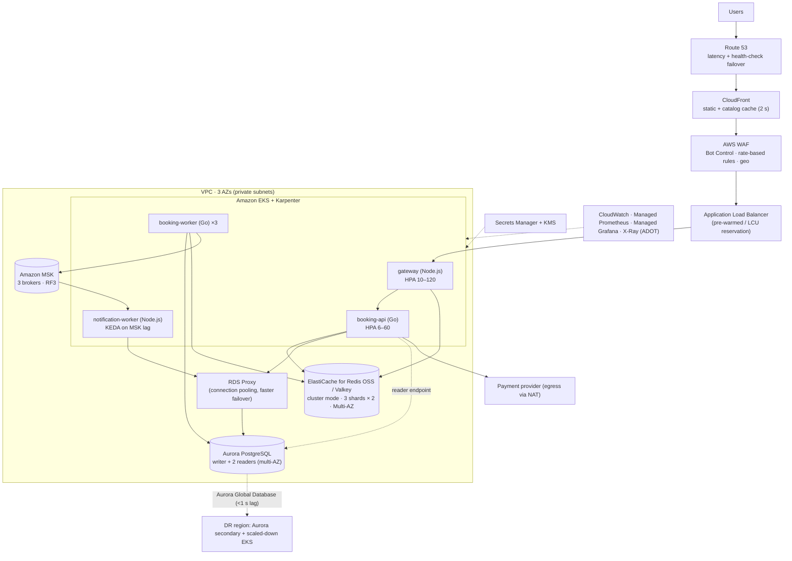

# AWS Reference Deployment

## Architecture

## Service mapping

| Concern | AWS service | Configuration notes |
|---|---|---|
| DNS / global failover | **Route 53** | Health checks on `/readyz` via ALB; failover record to DR region |
| CDN | **CloudFront** | Cache `/api/v1/events*` honouring `Cache-Control`; origin shield on; static SPA from S3 |
| Edge protection | **AWS WAF** + Bot Control + Shield Advanced | Rate-based rule per IP (e.g. 300/5 min on `/queue/*/join`); block known bots; CAPTCHA challenge on join for suspicious clients |
| L7 LB | **ALB** | Idle timeout 60 s (gateway keep-alive 65 s); for > 50k rps steps, pre-warm via AWS support or **LCU reservation** |
| Compute | **EKS** + **Karpenter** | Separate node pools: gateway on c7g (Graviton, compute), api on c7g/m7g; on-demand for the sale (Spot only for non-critical) |
| Postgres | **Aurora PostgreSQL** (or RDS Multi-AZ DB cluster) | Writer `db.r7g.4xlarge`; 2 readers; failover ~30 s (RDS Proxy shortens it and keeps client conns); Performance Insights on |
| Pooling | **RDS Proxy** (or PgBouncer on EKS) | Transaction pooling; workers connect to the writer endpoint directly (session advisory locks) |
| Redis | **ElastiCache (Redis OSS / Valkey), cluster mode enabled** | `cache.r7g.large` × 3 shards × 1 replica, Multi-AZ auto-failover, `maxmemory-policy noeviction`, TLS + AUTH. Separate small cluster for disposable cache |
| Kafka | **Amazon MSK** (provisioned) | 3 × `kafka.m7g.large`, RF 3, `min.insync.replicas=2`, IAM auth; or MSK Serverless for spiky low volume |
| Secrets | **Secrets Manager** + External Secrets Operator | Rotation for DB creds; JWT/queue keys with dual-key rotation |
| Observability | CloudWatch Container Insights, **Amazon Managed Prometheus/Grafana**, X-Ray via ADOT | Alerts from `docs/06` |
| Chaos | **AWS FIS** | AZ power interruption, Aurora failover, ElastiCache node reboot |
| DR | **Aurora Global Database**, ECR replication, EKS in DR region (min size) | RPO ~1 s, RTO ~15–30 min (managed planned/unplanned failover) |

## Sizing for a 1 M-user sale (one region)

| Component | Peak config | Approx. hourly cost driver |
|---|---|---|
| gateway | 60–80 pods × 1 vCPU (c7g.2xlarge nodes × ~12) | compute |
| booking-api | 15–20 pods × 2 vCPU | compute |
| Aurora writer | r7g.4xlarge (16 vCPU / 128 GB) + 2 readers | largest fixed cost |
| ElastiCache | 3 × r7g.large shards + replicas | |
| MSK | 3 × m7g.large | |
| ALB / CloudFront / WAF | per-request | scales with traffic |

Scale everything down after the sale. Aurora can drop a size via a writer failover; the EKS nodes are removed by Karpenter.

## HA & failover specifics

* **AZ failure:** pods are spread across 3 AZs (topology spread). Aurora promotes a reader in another AZ (~30 s). The app retries `57P01`/connection errors, and RDS Proxy keeps client connections open. ElastiCache promotes replicas. MSK keeps ISR ≥ 2.
* **Region failure:** Route 53 health check fails → runbook: Aurora Global *failover* to secondary → scale DR EKS (Karpenter) → admission rate 0 → DNS flip → gate resync rebuilds Redis from Aurora → reopen.
* Networking: VPC endpoints for ECR/S3/Secrets Manager (no NAT dependency for pulls); NAT gateway per AZ for PSP egress.

## Deploy checklist

1. Terraform: VPC (3 AZ), EKS, Karpenter, Aurora + RDS Proxy, ElastiCache, MSK, WAF, CloudFront, Route 53.
2. Build & push images to ECR (`services/*/Dockerfile`).
3. Install External Secrets, KEDA, metrics-server, AWS Load Balancer Controller.
4. `kubectl apply -k deploy/k8s` with endpoints replaced in `namespace.yaml`.
5. Run the k6 test from `loadtest/` at 1.5× peak; run the FIS experiments.
