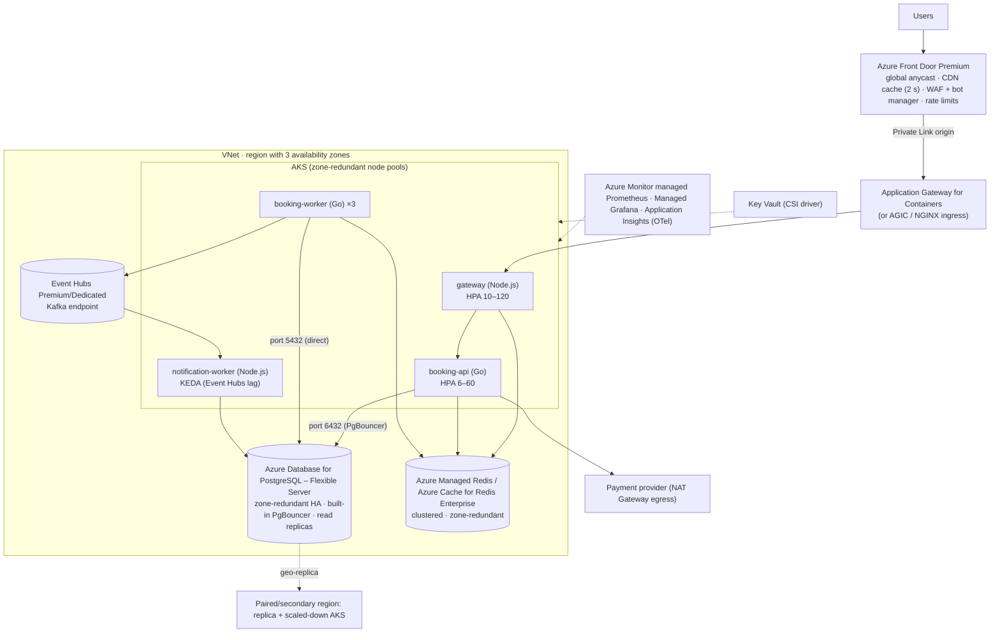

# Microsoft Azure Reference Deployment

## Architecture

## Service mapping

| Concern | Azure service | Configuration notes |
|---|---|---|
| Global entry, CDN, WAF | **Azure Front Door Premium** | Cache rules for `/api/v1/events*` (honour origin TTL); WAF managed rules + **Bot Manager**; rate-limit rule on `/queue/*/join`; Private Link to origin |
| L7 in-cluster | **Application Gateway for Containers** (or AGIC / NGINX) | Health probe `/readyz`; connection draining 30 s |
| Compute | **AKS** | Zone-redundant node pools (zones 1, 2, 3); cluster autoscaler + manual pre-scale; **KEDA add-on**; Azure CNI Overlay |
| Postgres | **Azure Database for PostgreSQL – Flexible Server** | **Zone-redundant HA** (sync standby, automatic failover ~60–120 s); read replicas for catalog; Memory-optimized `E16ds_v5` |
| Pooling | **Built-in PgBouncer** (Flexible Server, port 6432) | `pgbouncer.default_pool_size` ≈ 60–100; workers use 5432 directly (session advisory locks) |
| Redis | **Azure Managed Redis** (or Cache for Redis Enterprise) | Clustered, zone-redundant, `noeviction`, TLS, Entra ID auth |
| Kafka | **Event Hubs** (Kafka protocol endpoint) | Premium/Dedicated tier for predictable latency; partitions = consumer parallelism. Code works unchanged via the Kafka protocol (SASL/OAuth config) |
| Secrets | **Key Vault** + Secrets Store CSI driver | Managed identities (workload identity) |
| Observability | Azure Monitor managed Prometheus, Managed Grafana, **Application Insights** via OpenTelemetry, Container Insights | |
| Chaos | **Azure Chaos Studio** | AKS pod/node faults, zone-down, Redis reboot, PostgreSQL forced failover |
| DR | PostgreSQL geo-replica (promote), ACR geo-replication, secondary AKS; Front Door origin groups with priority | RPO seconds–minutes, RTO ~30 min |

## Sizing for a 1 M-user sale

| Component | Peak config |
|---|---|
| gateway | 60–80 pods × 1 vCPU (`Standard_F8s_v2` / `D8ps_v6` nodes × ~12) |
| booking-api | 15–20 pods × 2 vCPU |
| PostgreSQL Flexible | `Standard_E16ds_v5` zone-redundant HA, Premium SSD v2 (provisioned IOPS ≥ 20k), 1–2 read replicas |
| Managed Redis | Memory-optimized/Balanced clustered tier, ~13–25 GB, zone-redundant |
| Event Hubs | Premium, 2–4 processing units, 12–24 partitions |

## HA & failover specifics

* **Zone failure:** AKS keeps 2/3 of capacity (topology spread); PostgreSQL zone-redundant HA promotes the standby (the app's retry/backoff covers the 1–2 min window; waiting-room backpressure pauses admissions while the booking breaker is open); Redis zone-redundant replicas take over.
* **Region failure:** Front Door origin group priority switches to the secondary region's origin → promote the PostgreSQL geo-replica → scale secondary AKS → resync → reopen admissions.
* Event Hubs **Geo-replication** (Premium/Dedicated) or Geo-DR alias for the broker namespace.

## Deploy checklist

1. Bicep/Terraform: VNet, AKS (zones), PostgreSQL Flexible (ZR-HA, PgBouncer on), Managed Redis, Event Hubs, Front Door + WAF, Key Vault, ACR.
2. Push images to ACR; enable AKS workload identity and Key Vault CSI.
3. `kubectl apply -k deploy/k8s` (adjust `KAFKA_BROKERS` to `<namespace>.servicebus.windows.net:9093` with SASL).
4. k6 (Azure Load Testing supports k6/JMeter) at 1.5× peak, then Chaos Studio experiments.

## Cross-cloud equivalence

| Role | AWS | GCP | Azure |
|---|---|---|---|
| CDN + WAF + bots | CloudFront + WAF + Bot Control | Cloud CDN + Cloud Armor + reCAPTCHA | Front Door Premium + WAF + Bot Manager |
| Load balancer | ALB | Global external ALB | Front Door → App Gateway for Containers |
| Kubernetes | EKS + Karpenter | GKE (Autopilot/Standard) | AKS + KEDA add-on |
| PostgreSQL | Aurora PostgreSQL / RDS | Cloud SQL Enterprise Plus / AlloyDB | PostgreSQL Flexible Server |
| Pooler | RDS Proxy | PgBouncer / Managed Connection Pooling | Built-in PgBouncer |
| Redis | ElastiCache (cluster mode) | Memorystore for Redis Cluster | Azure Managed Redis |
| Kafka | MSK | Managed Service for Apache Kafka | Event Hubs (Kafka endpoint) |
| Secrets | Secrets Manager | Secret Manager | Key Vault |
| Metrics / traces | AMP + AMG + X-Ray | Managed Prometheus + Cloud Trace | Managed Prometheus + App Insights |
| Chaos | FIS | (GKE/Cloud SQL failover APIs) | Chaos Studio |
| Cross-region DB | Aurora Global Database | Cross-region replica | Geo-replica |
