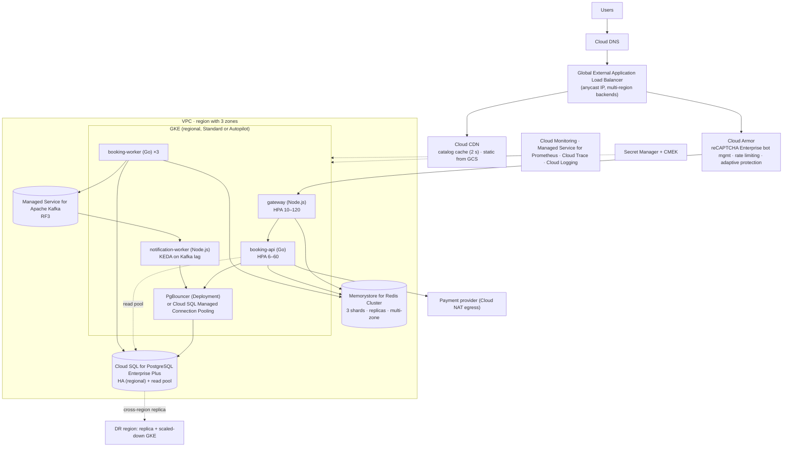

# Google Cloud Reference Deployment

## Architecture

## Service mapping

| Concern | GCP service | Configuration notes |
|---|---|---|
| DNS | **Cloud DNS** | Single anycast IP from the global LB, so failover happens at the LB, not in DNS |
| L7 LB | **Global external Application LB** | Backends = GKE NEGs (container-native LB). Health check `/readyz`. Request timeout 30 s |
| CDN | **Cloud CDN** | `CACHE_ALL_STATIC` + honour origin `Cache-Control` for `/api/v1/events*`; serve-stale on error |
| Edge protection | **Cloud Armor** (+ reCAPTCHA Enterprise) | Per-client rate-based ban on `/queue/*/join`; Adaptive Protection for L7 DDoS; bot challenge on join |
| Compute | **GKE regional cluster** | Node pools across 3 zones; `c3`/`t2a` for gateway; cluster autoscaler + **node pool pre-scaling** before sale; Image streaming for fast pod start |
| Postgres | **Cloud SQL for PostgreSQL Enterprise Plus** (or **AlloyDB**) | HA config (synchronous standby in another zone, failover < 60 s, near-zero downtime maintenance); read pool for catalog; Query Insights |
| Pooling | PgBouncer Deployment (transaction mode) or Cloud SQL Managed Connection Pooling | Workers connect directly via Cloud SQL Auth Proxy sidecar (session locks) |
| Redis | **Memorystore for Redis Cluster** | 3+ shards, 1 replica each, multi-zone, `maxmemory-policy noeviction`, IAM + in-transit encryption |
| Kafka | **Google Cloud Managed Service for Apache Kafka** | RF 3, `min.insync.replicas=2`; alternative: **Pub/Sub** with ordering keys (replace `KafkaPublisher`) |
| Secrets | **Secret Manager** via Secret Manager CSI / External Secrets | |
| Observability | Managed Service for Prometheus (scrapes `/metrics`), Cloud Trace (OTel), Cloud Logging (JSON logs parsed) | SLO monitoring on reserve latency |
| Chaos | Fault injection via GKE node/zone drain, Cloud SQL failover API, Memorystore manual failover | |
| DR | Cross-region Cloud SQL replica (promote), Artifact Registry multi-region, standby GKE | RPO seconds, RTO ~30 min |

## Sizing for a 1 M-user sale

| Component | Peak config |
|---|---|
| gateway | 60–80 pods × 1 vCPU (`c3-standard-8` nodes × ~12) |
| booking-api | 15–20 pods × 2 vCPU |
| Cloud SQL | `db-perf-optimized-N-16` (16 vCPU, 128 GB) HA + 1–2 read replicas; data cache enabled |
| Memorystore Cluster | 3 shards (`redis-highmem-medium`) + replicas |
| Managed Kafka | 3 brokers worth of vCPU (e.g. 12 vCPU / 48 GB cluster) |

## HA & failover specifics

* **Zone failure:** regional GKE plus pod topology spread; Cloud SQL HA fails over to the standby zone automatically (connections drop, and the app retries transparently); Memorystore Cluster promotes replicas.
* **Region failure:** the global LB is already anycast. Point the backend service at the DR region's NEGs → promote the Cloud SQL cross-region replica → admission 0 → scale DR GKE → resync → reopen.
* GKE Autopilot is a good fit for the stateless tiers. Use **Balanced/Performance** compute classes and set realistic `requests`, since Autopilot bills by request.

## Deploy checklist

1. Terraform: VPC + Cloud NAT, GKE regional, Cloud SQL HA + replicas, Memorystore Cluster, Managed Kafka, Cloud Armor policy, global LB + CDN.
2. Push images to Artifact Registry.
3. Install External Secrets/CSI, KEDA, GKE Gateway API or Ingress for NEGs.
4. `kubectl apply -k deploy/k8s` with endpoints from Terraform outputs.
5. k6 at 1.5× peak (k6 Operator on a separate GKE cluster), then failover drills.
